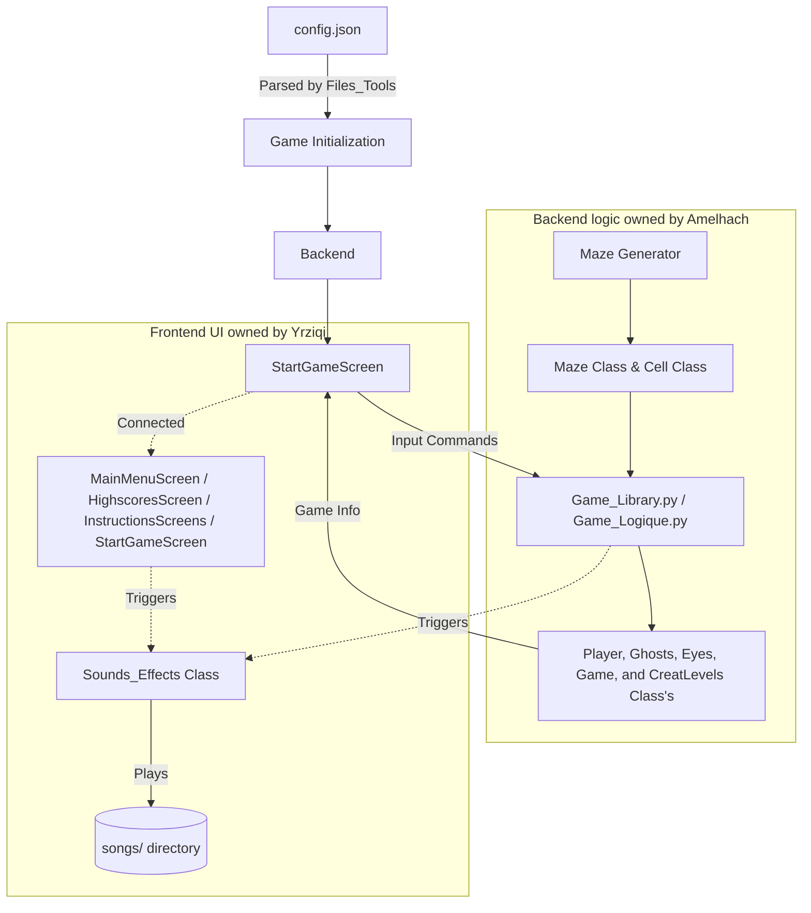

*This project has been created as part of the 42 curriculum by [amelhach, yrziqi].*

# Pac-Man — Ghosts! More ghosts!

## Table of Contents
1. [Description](#1-description)
2. [Instructions](#2-instructions)
3. [Resources](#3-resources)
4. [Configuration](#4-configuration)
5. [Highscore](#5-highscore)
6. [Maze Generation](#6-maze-generation)
7. [Implementation](#7-implementation)
8. [General Software Architecture](#8-general-software-architecture)
9. [Project Management](#9-project-management)
10. [Technical Choices](#10-technical-choices)
11. [Project Structure](#11-project-structure)

---

## 1. Description

The objective of this project was to implement a fully functional, highly polished version of the classic arcade game **Pac-Man**, utilizing Python and the MLX graphical library. The team's goal was not merely to satisfy the minimum requirements but to build a robust, complete experience that incorporates extensive gameplay mechanics, custom pixel-art aesthetics, and a comprehensive audio system.

The core gameplay loop requires the player to navigate a procedurally generated maze, collect all Pac-Gums, and avoid chasing ghosts. Collecting a Super Pac-Gum temporarily turns ghosts edible, altering the dynamic of the maze. Progressing through levels increases the challenge.

**Features Beyond the Baseline:**
- **Power-Ups**: Magnet (pulls items), Booster (speed increase), and Extra Lives.
- **Bombs**: Spawn every second; touching one sends Pac-Man or a ghost back to their spawn point.
- **Extra Time**: Appears when 20 seconds remain; collecting it adds 20 seconds to the timer.
- **Magnet**: Attracts nearby Pac-Gums toward Pac-Man.
- **Maze Features**: Tunnels on the edges teleport the player from one side of the maze to the other.
- **Advanced Ghost Systems**: Edible state, ghost respawning with "eyes" retreating to the center, freezing, and line-of-sight vision logic that triggers a troll sound when a ghost spots the player.
- **Cheat Mode**: Developer controls allowing speed modification, player invincibility, and ghost freezing.
- **Polished UX/UI**: Dedicated Main Menu, Start Game screen, Instructions screen, Top 10 Highscore screen, Game Over and Win screens.
- **Audio Integration**: Dynamic gameplay sounds and background music responding to specific game triggers.

---

## 2. Instructions

### Requirements
Based on the `pyproject.toml` and `Makefile`, the project requires:
- **Python 3.12+**
- **uv** (Package manager for dependencies)
- **MLX** (Handled via local wheel in `ubuntu/`)
- **mazegenerator** (Handled via local wheel in `mazegenerator/`)
- **pygame-ce** (For audio management)

### Installation
The project relies on `uv` to sync dependencies. Run the following command in the project root:
```bash
make install
```

### Running the Game
To launch the game from the source code, provide the configuration file as the single argument:
```bash
make run
# Which executes: uv run python3 src/pac-man.py config.json
```

### Packaged Executable
The project provides a PyInstaller packaging target. To build the standalone executable:
```bash
make package
```
*Note: The generated executable includes `Images`, `songs`, and the `mlx` dependency. Executables are platform-specific.*

**Official Release:**
You can also get the pre-packaged binary directly from our official distribution page:
 [Play / Download Pacman on itch.io](https://amine-elh.itch.io/pacman-binary)

### Controls
| Action | Key |
| :--- | :--- |
| **Move Up** | `Up Arrow` or `W` |
| **Move Down** | `Down Arrow` or `S` |
| **Move Left** | `Left Arrow` or `A` |
| **Move Right** | `Right Arrow` or `D` |
| **Exit Game** | `Escape` |

*(Additional developer/cheat controls are available during gameplay to manipulate speeds, toggle invincibility, or freeze ghosts if activated in the backend).*

---

## 3. Resources

### Technical Resources
- [Python 3.15.0 Documentation](https://docs.python.org/3/)
- [MLX Framework Reference](https://harm-smits.github.io/42docs/libs/minilibx/introduction.html)
- [PyInstaller Documentation](https://pyinstaller.org/en/stable/)
- [uv Package Manager](https://docs.astral.sh/uv/)

### AI Usage
AI was utilized transparently throughout the project as an **assistance and reference tool**. Its usage included:
- Helping with project management and organizing/updating project documentation.
- Helping explain technical concepts.
- Helping explain how sounds work (`pygame.mixer`).
- Helping with general explanations and documentation formatting.
- Helping understand and debug packaging concepts such as PyInstaller.
- Understanding and using MLX functions to initialize the library, create windows and images, and display images within a window.

*The team independently designed the architecture, wrote the source code, prepared the visual assets using LibreSprite, integrated the systems, and manually tested the application. AI did not autonomously generate the project or implement features without direct team oversight and rewriting.*

---

## 4. Configuration

The game utilizes a JSON configuration file (`config.json`) passed as an argument at runtime to define initial states per level.

### Configuration Format
The parser (`src/Files_Tools.py`) reads the file and validates the keys. The configuration is structured dynamically by level names (e.g., `"level 1"`, `"level 2"`).

| Key | Expected Type | Default | Description |
| :--- | :--- | :--- | :--- |
| `lives` | Integer | `3` | Number of starting lives for the player. |
| `points_per_pacgum` | Integer | `1` | Score awarded per standard Pac-Gum. |
| `points_per_super_pacgum` | Integer | `5` | Score awarded per Super Pac-Gum. |
| `points_per_ghost` | Integer | `20` | Score awarded for eating an edible ghost. |
| `level_max_time` | Integer | `200` | The time limit/threshold for the current level. |

### Validation & Error Handling
The configuration loader includes a robust fallback system:
- **Missing File / Invalid JSON**: If the file does not exist or contains invalid JSON, the system raises an error and exits the program.
- **Invalid Values**: Values (e.g., strings where integers are expected, or integers `<= 0`) are ignored, and a visible terminal warning (`Warning in level X: Invalid 'key'. Default Used.`) is printed instead of crashing the program with a traceback.

### Example of a Valide `config.json`
```json
{
    "level 2": { "lives": 3, "level_max_time": 200},
    
    "level 3": { "lives": 5}
}
```

---

## 5. Highscore

The highscore system dynamically tracks the Top 10 players, storing the data persistently in a JSON file (`src/highscores.json`). 

**Implementation & Rationale:**
- **Storage Strategy**: When a game ends via a Game Over, the player is prompted to enter their name on a dedicated UI screen (`Enter_Score_Name_Screen.py`). The score is inserted into the dictionary, which is then re-sorted in descending order and he start clean at the first start of the game.
- **Why JSON?**: A simple text-based JSON file was chosen because it allows easy serialization and deserialization in Python without requiring external database dependencies. It is robust enough to persist scores between application runs and can easily be packaged via PyInstaller.

---

## 6. Maze Generation

The project implements procedural maze generation using the required **A-Maze-ing** package, imported locally via the provided wheel (`mazegenerator`).

**How it works:**
1. **Instantiation**: The backend initializes `MazeGenerator(columns, rows, seed)` passing the required dimensions and the specific random seed loaded from `config.json`.
2. **Translation**: The `mazegenerator` natively outputs numerical bitwise representations for walls. Instead of forcing the game logic to parse raw integers (e.g., `2`, `4`, `8`), the project iterates over `self._generator.maze[y][x]` and constructs a structured grid of `Cell` objects.
3. **Internal Representation**: Each `Cell` dataclass translates the bits into explicit boolean properties (e.g., `up`, `down`, `left`, `right`). This design decision significantly improves code readability for player/ghost collision and movement logic.
4. **Special Placement**: After the walls are defined, the generator populates the cells with standard Pac-Gums, power-ups, and designates spawn locations ect.

---

## 7. Implementation

### Game Core
The game flow is driven by a central loop that handles user inputs, updates backend logic, checks collisions, updates timers, and commands the MLX frontend to render the current frame.

 Main Menu > start game > Win or Lose > Enter name for highscore > Back to Main Menu

### Player
The Player object tracks `x, y` coordinates, current movement direction, speed modifiers, lives, and score. It verifies movement legality against the `Maze` grid's boolean wall constraints.

### Ghosts
Ghosts utilize advanced movement logic. When a Super Pac-Gum is eaten, ghosts enter an `edible` state and change their speed. If eaten by the player, they transition into the `eyes` state and return to their initial spawn positions at the corners of the maze to respawn (`handle_ghost_respawn`, `move_eyes`).
### Power-Ups and Hazards
Beyond standard Pac-Gums, the game implements:
- **Magnet**: Automatically pulls nearby items towards the player.
- **Tunnels**: Edge corridors that immediately teleport the player to the opposite side of the maze.
- **Extra Life**: When the player has only one life remaining, an extra heart appears in the maze. Collecting it grants the player one additional life.
- **Extra Life**: When the player has only one life remaining, an extra heart appears in the maze. Collecting it grants the player one additional life.
- **Booster**: When the player eat the Booster get more speed for smal period.
- **Bombs**: Bombs respawn in the maze every second. When a bomb collides with the player or a ghost, the affected character respawns at their initial spawn position, and the maze shakes to indicate the explosion.

### Sound Integration
Sound logic (`Sounds_Effects.py`) is decoupled from rendering. The backend detects gameplay events (e.g., collision, eating a pacgum, ghost returning to spawn, ghost spotting the player) and triggers specific methods on the `Sounds` object to play the corresponding audio files located in the `songs/` directory.

The system uses `pygame.mixer` to initialize audio and `pygame.mixer.Sound` to load files. Custom methods like `play()` and `stop()` are wrapped to handle background intro music, eating sounds, tunnel movement, and ghost troll sounds.

### Error Handling
The team implemented defensive programming. Exceptions in configuration loading or missing UI assets are caught and logged clearly via custom `FileTools.error_raise_message` functions, preventing arbitrary hard crashes.

---

## 8. General Software Architecture

The architecture relies on a clear separation of concerns, heavily utilizing object-oriented principles.



---

## 9. Project Management

The project was managed iteratively, focusing on parallel development through a strict **Backend/Frontend separation**.
- **Amelhach (Backend)**: Handled maze generation, entity logic, collision math, sounds effects and the underlying game systems.
- **Yrziqi (Frontend)**: Owned MLX implementation, UI screens, configuration integration, and asset layering.

This separation prevented merge conflicts and provided clear ownership. The integration was bridged using structured dataclasses (the `Cell` grid), allowing the frontend to easily query backend states. The team maintained continuous communication via Discord and GitHub. 

For complete documentation on the timeline, risk analysis, testing plans, and lessons learned, see the [Project Management Documentation](project-management/README.md).

---

## 10. Technical Choices

- **Direct MLX Usage**: Opting to use MLX directly instead of wrapper libraries allowed fine-grained control over image layering and UI visualization, which was crucial for the custom screens.
- **PyInstaller**: Selected to satisfy distribution requirements. The `pacman.spec` file ensures that MLX, `Images`, and `songs` are bundled correctly, abstracting the complex Python environment from the end-user.

---

## 11. Project Structure

```text
pac-man/
├── src/                    # Python source code (Entry point, logic, UI screens)
├── Images/                 # Custom pixel-art UI and sprite assets
├── songs/                  # Audio files for sound effects and background music
├── mazegenerator/          # Provided A-Maze-ing local wheel dependency
├── ubuntu/                 # Local MLX wheel dependency
├── project-management/     # Project timeline, risk analysis, and team docs
├── config.json             # Runtime configuration variables
├── Makefile                # Commands for installation, execution, and packaging
├── pyproject.toml          # Dependency declarations
├── uv.lock                 # Dependency lockfile
├── Pacman.spec             # PyInstaller build configuration
└── README.md               # Project documentation
```
