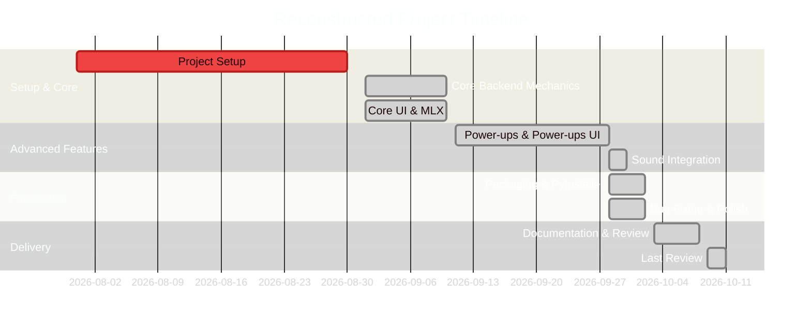

# 03 Project Timeline

## Development Progression
Based on the Git history, the project did not follow a rigid predefined schedule. Instead, it was developed progressively, feature by feature.

### Reconstructed Timeline Phases
1. **Initial Setup (Late July - Late August)**: Base project files, initial git setup (`pac-man` init).
2. **Core Mechanics (Early September)**: 
   - Moving ghosts in the maze.
   - Player movement and collisions.
   - Core visual components (coloured virtual printed maze, MLX added).
3. **Advanced Features (Mid to Late September)**: 
   - Power-ups (Boosters, Magnets, Extra lives, Bombs).
   - Cheat modes.
   - Audio integration (Sounds added for various triggers).
4. **Finalisation and Packaging (End of September - Early October)**: 
   - Executable generation and testing.
   - Code optimisation, bug fixing, flake8 and mypy linting.
5. **Documentation & Final Delivery (Early October)**: 
   - Updating README and project management documents.
   - Final review of implemented mechanics and codebase state.

## Gantt Chart Representation

*(Evidence: Git commit history dates spanning from 2026-07-31 to 2026-10-08)*
